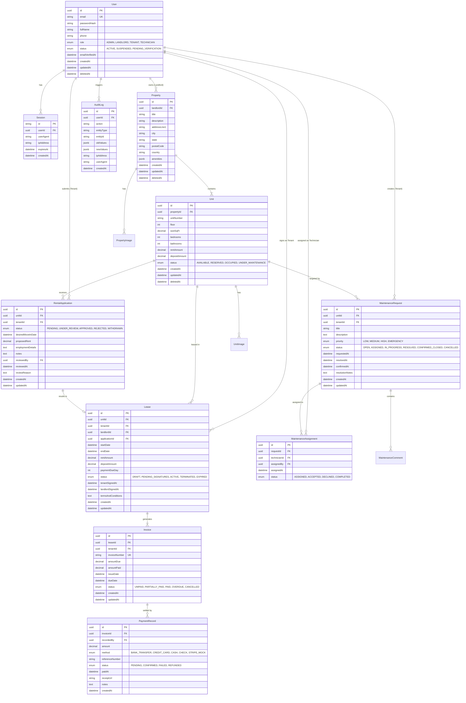

# RentEase — System Architecture & Implementation Plan (Phase 1)

## 1. Repository Inspection Summary

- **Framework**: Nuxt 4.6.2 with Vue 3.5.44 and Vue Router 5.4.0.
- **Project Structure**: Default Nuxt 4 directory layout (`app/` directory convention for client code, root for config and server assets).
- **Current State**: Bare starter template with `app/app.vue`. No ORM, database client, UI library, or testing harness installed yet.
- **Source Control**: Git is not yet initialized in the project directory.

---

## 2. System Architecture & Tech Stack

```
┌────────────────────────────────────────────────────────────────────────┐
│                        RentEase Client Layer                           │
│  Nuxt 4 (Vue 3 Composition API, Nuxt UI v3 / Tailwind CSS, Pinia/Zustand) │
└───────────────────────────────────┬────────────────────────────────────┘
                                    │ HTTP / Secure HTTP-Only Cookie
                                    ▼
┌────────────────────────────────────────────────────────────────────────┐
│                      Nitro Server Layer (Nuxt 4)                       │
│  - Middleware: Auth Session Resolver, CSRF Shield, Rate Limiter        │
│  - Event Handlers: /api/v1/* (Zod validation, error handling)         │
│  - Services: Business logic (Domain Services)                          │
│  - Repositories: Data access layer & transaction boundaries            │
└───────────────────────────────────┬────────────────────────────────────┘
                                    │ Prisma Client
                                    ▼
┌────────────────────────────────────────────────────────────────────────┐
│                   PostgreSQL Database & File Storage                  │
│  - PostgreSQL: Relational tables, indexes, constraints, audit logs     │
│  - Storage: S3 / MinIO / Local storage driver for receipts & photos    │
└────────────────────────────────────────────────────────────────────────┘
```

### Core Architectural Decisions

1. **Nuxt 4 Layer Separation**:
   - `app/`: Client-side UI (pages, components, composables, layouts, assets).
   - `server/`: Nitro backend (API event handlers, middleware, services, repositories, database client, email/notification handlers).
   - `shared/`: Shared domain types, Zod schemas, error definitions, and validation contracts shared safely between client and server without leaking server secrets.
2. **Database & ORM**: PostgreSQL with Prisma ORM. Prisma schema defines strictly-typed models with composite indexes, foreign key cascades, and unique constraints.
3. **Session Management & Authentication**:
   - Database-backed sessions stored in PostgreSQL with cryptographically random session IDs.
   - Session tokens passed via HTTP-only, secure, `SameSite=Lax` cookies.
   - Passwords hashed using `scrypt` / `argon2id` (or Node.js native `crypto.scrypt`).
4. **Validation**: Zod runtime schema validation on all incoming request queries, params, and bodies at the API boundary before hitting business services.
5. **Security & Data Isolation**:
   - Explicit tenant/landlord isolation checks at the repository/service layer (IDOR mitigation).
   - Database transactions (`prisma.$transaction`) for state transitions:
     - Application approval & lease generation.
     - Lease termination & unit status reset.
     - Invoice creation & payment reconciliation.
6. **Testing Strategy**:
   - **Vitest**: Unit testing for utility functions, Zod schemas, and business services with mocked repositories.
   - **Playwright**: End-to-end integration flows (Auth, Application -> Lease -> Invoice -> Maintenance).

---

## 3. Proposed Directory Structure

```text
property-rental-management-platform/
├── .env.example
├── .gitignore
├── docker-compose.yml
├── Dockerfile
├── nuxt.config.ts
├── package.json
├── tsconfig.json
├── prisma/
│   ├── schema.prisma
│   ├── seed.ts
│   └── migrations/
├── app/
│   ├── app.vue
│   ├── assets/
│   │   └── css/
│   │       └── main.css
│   ├── components/
│   │   ├── common/             # Button, Modal, Card, DataTable, Badge
│   │   ├── auth/               # LoginForm, RegisterForm, PasswordResetForm
│   │   ├── properties/         # PropertyCard, PropertyForm, UnitList
│   │   ├── leases/             # LeaseAgreementViewer, LeaseSignModal
│   │   ├── invoices/           # InvoiceTable, PaymentRecordModal
│   │   └── maintenance/        # RequestCard, TechnicianAssignmentModal
│   ├── composables/
│   │   ├── useAuth.ts          # Authentication client state
│   │   ├── useNotification.ts  # Toast and alert handling
│   │   └── useApiFetch.ts      # Typed client wrapper around $fetch
│   ├── layouts/
│   │   ├── default.vue         # Public/marketing layout
│   │   ├── auth.vue            # Login/Register layout
│   │   └── dashboard.vue       # Authenticated role-based dashboard layout
│   ├── middleware/
│   │   ├── auth.ts             # Client-side route protection
│   │   └── role.ts             # Role-based route guard
│   └── pages/
│       ├── index.vue
│       ├── login.vue
│       ├── register.vue
│       ├── reset-password.vue
│       └── dashboard/
│           ├── index.vue
│           ├── properties/
│           ├── applications/
│           ├── leases/
│           ├── invoices/
│           ├── maintenance/
│           ├── users/          # Admin-only
│           └── audit-logs/     # Admin-only
├── shared/
│   ├── types/                  # Shared TypeScript interfaces & enums
│   │   ├── auth.ts
│   │   ├── property.ts
│   │   ├── lease.ts
│   │   ├── billing.ts
│   │   └── maintenance.ts
│   └── schemas/                # Zod schemas for shared client/server validation
│       ├── auth.schema.ts
│       ├── property.schema.ts
│       ├── application.schema.ts
│       ├── billing.schema.ts
│       └── maintenance.schema.ts
├── server/
│   ├── api/
│   │   └── v1/
│   │       ├── auth/
│   │       ├── users/
│   │       ├── properties/
│   │       ├── units/
│   │       ├── applications/
│   │       ├── leases/
│   │       ├── invoices/
│   │       ├── payments/
│   │       ├── maintenance/
│   │       ├── audit-logs/
│   │       └── reports/
│   ├── middleware/
│   │   ├── 01.auth.ts          # Session extraction & context attachment
│   │   └── 02.rate-limit.ts    # Rate limiting for auth & sensitive routes
│   ├── services/               # Core business logic
│   │   ├── auth.service.ts
│   │   ├── property.service.ts
│   │   ├── lease.service.ts
│   │   ├── billing.service.ts
│   │   ├── maintenance.service.ts
│   │   └── audit.service.ts
│   ├── repositories/           # Prisma data access queries
│   │   ├── user.repo.ts
│   │   ├── property.repo.ts
│   │   ├── lease.repo.ts
│   │   └── invoice.repo.ts
│   └── utils/
│       ├── db.ts               # Prisma client singleton
│       ├── session.ts          # Session helper & cookie encryption
│       ├── permissions.ts      # Role-based authorization guard helpers
│       ├── logger.ts           # Structured logging
│       └── errors.ts           # Standardized API error responses
└── tests/
    ├── unit/
    └── e2e/
```

---

## 4. Database ERD & Entity Relationships



---

## 5. Role-Based Access Control (RBAC) Matrix

| Domain Resource          | Action                    |        Admin         |     Landlord     |     Tenant     |   Technician   |
| :----------------------- | :------------------------ | :------------------: | :--------------: | :------------: | :------------: |
| **Users & Accounts**     | Create/Invite             |         Yes          |        No        |       No       |       No       |
|                          | View Profiles             |         All          | Self/Own Tenants | Self/Landlord  |      Self      |
|                          | Suspend/Activate          |         Yes          |        No        |       No       |       No       |
| **Properties & Units**   | Create / Edit / Delete    |         All          |  Own Properties  |       No       |       No       |
|                          | View Listings             |         All          |  Own Properties  | Available/All  | Assigned Only  |
| **Applications**         | Submit                    |          No          |        No        |   Yes (Self)   |       No       |
|                          | Review / Approve / Reject |         All          |  Own Properties  | View Self Only |       No       |
| **Lease Agreements**     | Create Draft              |         All          |  Own Properties  |       No       |       No       |
|                          | Sign Lease                | All (Admin override) |  Landlord Sign   |  Tenant Sign   |       No       |
|                          | Terminate Lease           |         All          |    Own Leases    |       No       |       No       |
| **Invoices & Billing**   | Generate / Issue          |         All          |    Own Leases    | View Self Only |       No       |
|                          | Record / Confirm Payment  |         All          |   Own Invoices   |  Submit proof  |       No       |
|                          | View Invoices & Receipts  |         All          |    Own Leases    | Self Invoices  |       No       |
| **Maintenance**          | Create Request            |         All          |  Own Properties  | Own Unit Only  |       No       |
|                          | Assign Technician         |         All          |  Own Properties  |       No       |       No       |
|                          | Update Progress / Resolve |         All          |  Own Properties  |       No       | Assigned Tasks |
|                          | Confirm Resolution        |         All          |  Own Properties  |  Own Request   |       No       |
| **Audit Logs & Reports** | View Global Audit Logs    |         Yes          |        No        |       No       |       No       |
|                          | View Financial Reports    |    Platform-wide     |  Own Properties  |  Self History  |       No       |

---

## 6. Comprehensive REST API Plan

All endpoints prefixed with `/api/v1` and return uniform envelope format:
`{ success: boolean, data?: T, error?: { code: string, message: string, details?: any } }`

### Authentication (`/api/v1/auth`)

- `POST /register`: Register user (Tenant default or Landlord request).
- `POST /login`: Validate credentials, issue secure HTTP-only session cookie.
- `POST /logout`: Invalidate session in database, clear cookie.
- `GET  /me`: Fetch authenticated user profile & assigned permissions.
- `POST /password-reset/request`: Generate secure single-use reset token.
- `POST /password-reset/confirm`: Validate token and update password.

### Properties & Units (`/api/v1/properties`, `/api/v1/units`)

- `GET    /properties`: Paginated list (filtered by owner or search query).
- `POST   /properties`: Create property (Landlord/Admin).
- `GET    /properties/:id`: View property details with units.
- `PUT    /properties/:id`: Update property attributes.
- `DELETE /properties/:id`: Soft delete property.
- `POST   /properties/:id/units`: Add unit to property.
- `GET    /units/:id`: Unit details, pricing, status, and amenities.
- `PATCH  /units/:id/status`: Change unit status (`AVAILABLE`, `UNDER_MAINTENANCE`, etc.).

### Applications & Leases (`/api/v1/applications`, `/api/v1/leases`)

- `POST   /applications`: Submit rental application for available unit.
- `GET    /applications`: List applications (scoped to Tenant or Landlord).
- `PATCH  /applications/:id/review`: Approve/reject application.
- `POST   /leases`: Generate lease agreement draft (Landlord/Admin).
- `GET    /leases/:id`: Fetch lease terms, signatures, and current status.
- `POST   /leases/:id/sign`: Record digital signature (Tenant/Landlord).
- `POST   /leases/:id/terminate`: Early termination / cancellation with reason.

### Billing & Payments (`/api/v1/invoices`, `/api/v1/payments`)

- `GET    /invoices`: List invoices (scoped to Tenant/Landlord/Admin).
- `POST   /invoices/generate`: Generate monthly invoice for active lease.
- `GET    /invoices/:id`: Single invoice with breakdown and payment history.
- `POST   /payments/record`: Record manual or offline payment (Bank Transfer/Cash).
- `GET    /payments/:id/receipt`: Download or view payment receipt summary.

### Maintenance (`/api/v1/maintenance`)

- `POST   /maintenance/requests`: Tenant submits new maintenance ticket.
- `GET    /maintenance/requests`: List requests (filtered by status/unit/assignee).
- `PATCH  /maintenance/requests/:id/assign`: Assign technician to request.
- `PATCH  /maintenance/requests/:id/status`: Technician updates status to `IN_PROGRESS` or `RESOLVED`.
- `POST   /maintenance/requests/:id/confirm`: Tenant confirms repair completion.

### Administration & Audit Logs (`/api/v1/admin`)

- `GET    /admin/users`: Manage user accounts and statuses.
- `GET    /admin/audit-logs`: Query filterable audit log events with IP/Agent data.
- `GET    /admin/reports/occupancy`: Occupancy rates and property performance.
- `GET    /admin/reports/financials`: Revenue collected, pending, and overdue balances.

---

## 7. Key Risks & Security Controls

1. **Broken Object Level Authorization (BOLA/IDOR)**:
   - _Risk_: A malicious tenant queries or modifies another tenant's lease or invoice by guessing UUIDs.
   - _Control_: Every repository and service method enforces tenancy check (`WHERE id = :id AND (landlordId = :userId OR tenantId = :userId)`).
2. **Double-Leasing / Race Conditions on Units**:
   - _Risk_: Two applications approved simultaneously, leading to conflicting active leases for the same unit.
   - _Control_: Strict PostgreSQL isolation and row locking (`SELECT FOR UPDATE`) within `prisma.$transaction`. Unit status updated to `RESERVED` atomically upon approval.
3. **Payment Integrity & Mock Separation**:
   - _Risk_: Client claims payment was made by posting status `PAID`.
   - _Control_: Clients can only submit payment intent or proof of transfer. Only Landlords or Admins can confirm offline payments, and automated webhooks with cryptographic signature verification are required for payment gateways.
4. **Credential Exposure & Session Hijacking**:
   - _Risk_: Stolen cookies or brute-force credential stuffing.
   - _Control_: `HttpOnly`, `Secure`, `SameSite=Lax` cookies, rate limiting on `/auth/*` endpoints via Nitro middleware, and secure password hashing using Node `scrypt`.
5. **Data Auditability**:
   - _Risk_: Unauthorized rent changes or dispute over lease terms.
   - _Control_: Dedicated `AuditLog` service logging before/after states for all sensitive operations (application review, lease signing, invoice modifications, payment recordings).

---

## 8. Phased Implementation Roadmap

- [x] **Phase 1: Architecture, ERD, RBAC, and Environment Setup** _(Completed)_
  - System architecture document, ERD, and API contracts.
  - Dependencies: `@prisma/client`, `prisma`, `zod`, `@nuxtjs/tailwindcss`, `@lucide/vue`, `bcryptjs`, `vitest`.
  - Configured `nuxt.config.ts`, `tailwind.config.ts`, and comprehensive `.env.example`.
- [x] **Phase 2: Database Schema, Migrations, Authentication & Authorization** _(Completed)_
  - Complete `prisma/schema.prisma` with all models, constraints, and indexes.
  - Migration script and seed script with test accounts for each role.
  - Session auth engine (cookie-based, Nitro server middleware, RBAC guards).
  - Auth UI pages (Login, Register, Dashboard shell) adhering to strict flat design & no emojis.
- [x] **Phase 3: Property & Unit Management** _(Completed)_
  - Property and unit CRUD with amenities, pricing, and images.
  - Landlord management UI (`/dashboard/properties`, `/dashboard/properties/create`, `/dashboard/properties/[id]`, `/dashboard/properties/[id]/edit`).
  - Public & tenant property browsing (`/properties`, `/properties/[id]`).
- [x] **Phase 4: Rental Applications & Lease Workflows** _(Completed)_
  - Application submission, landlord review/approval flow with reason notes.
  - Automatic lease generation upon application approval.
  - Digital signature flow (tenant and landlord dual-signing).
  - Atomic unit state transitions (AVAILABLE -> RESERVED -> OCCUPIED -> AVAILABLE).
- [x] **Phase 5: Invoices, Payment Records & Scheduled Billing** _(Completed)_
  - Monthly rent invoice generation engine with sequential numbering (`INV-YYYY-XXXXXX`).
  - Dual-mode payment processing (tenant online card/Stripe mock, landlord cash/check/wire recording).
  - Automated status transitions (`UNPAID` -> `PARTIALLY_PAID` -> `PAID` / `OVERDUE`).
  - Printable official digital payment receipts (`RCPT-YYYY-XXXXXX`) with breakdown.
  - Dashboard invoice ledger UI (`/dashboard/invoices`) adhering to strict flat UI design standards.
- [x] **Phase 6: Maintenance Management & Notifications** _(Completed)_
  - End-to-end maintenance ticket lifecycle: Tenant report -> Landlord assignment -> Technician resolution -> Tenant confirmation.
  - Priority levels (`LOW`, `MEDIUM`, `HIGH`, `EMERGENCY`) and status tracking (`OPEN`, `ASSIGNED`, `IN_PROGRESS`, `RESOLVED`, `CONFIRMED_CLOSED`).
  - Notification repository and dispatch system with real-time in-app alerts.
  - Topbar `NotificationBell` with unread badge counter, popover menu, and mark-as-read functionality.
  - Full-featured dashboard management interface (`/dashboard/maintenance`) adhering to strict flat UI design standards.
- [x] **Phase 7: Dashboards, Reports, Audit Logs & Performance** _(Completed)_
  - Role-specific dashboards (Admin, Landlord, Tenant, Technician) with live dynamic metrics.
  - Filterable audit logs ledger (`/dashboard/audit-logs`) with actor/action/entity filters and state inspection diff modal.
  - User governance console (`/dashboard/users`) with account suspension/activation workflows and audit trail.
  - Dedicated reports & analytics portal (`/dashboard/reports`) with real-time occupancy distribution and revenue collection meters + CSV export.
- [x] **Phase 8: Comprehensive Testing, Docker, CI/CD & Production Hardening** _(Completed)_
  - Vitest unit test suite (42 unit and integration lifecycle tests passing).
  - Playwright E2E test suite (`auth.spec.ts`, `public-listings.spec.ts`, `dashboard.spec.ts`) with `playwright.config.ts`.
  - Multi-stage production `Dockerfile` with non-root security user, Alpine base, and container health probes.
  - Production `docker-compose.yml` for PostgreSQL 16 + RentEase App with healthcheck dependencies.
  - GitHub Actions CI/CD pipeline (`.github/workflows/ci.yml`) for linting, typechecking, tests, build, and Docker validation.
